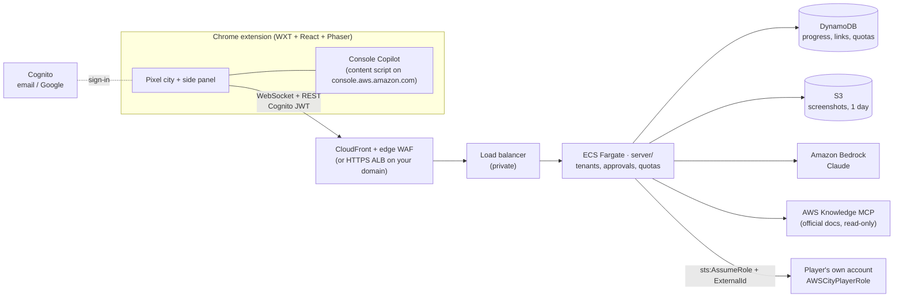

# 🏙️ AWS City

**Learn AWS by living in it.** AWS City is a Chrome extension with a living isometric pixel city,
where every AWS service is a place and its agent does that service's real job:
- Sally fishes objects out of **S3 Lake**.
- Sir Shieldon blocks DDoS arrows at the **Shield Wall**.
- Ruby pairs DNS dancers at the **Route 53 Dance Hall**.
- Lola only cooks when an order arrives at the **Lambda Food Stall**.

You are **Kai**. Browse the AWS Console and the city grows with you.

**What you can do**
- **Ask anything.** The agents answer in plain words, grounded in the official AWS docs, with links.
- **Console Copilot.** Tick *Do it in my console* and an agent walks you through real AWS Console
  pages. It highlights each button and explains why; risky buttons are always your click.
- **Build for real, safely.** Connect *your own* AWS account with a small, restricted role. Every
  change waits for your **Approve**.
- **Learn:**
  - 288 flashcards;
  - architecture puzzles scored on the 6 Well-Architected pillars;
  - quests;
  - 4 mini-games.

---

## Choose your path

| | You need | Time | Command |
|---|---|---|---|
| **1. Play now** (demo agents, no AWS) | Node 22+ | 2 min | `npm install && npm run open` |
| **2. Run it on your own AWS** (real agents, sign-in, alarms) | an AWS account + Docker | ~25 min, mostly waiting | `npm run setup` |
| **3. Develop against real AWS locally** | an AWS profile with Bedrock | 5 min | `npm run live` |

### 1 · Play now

```bash
git clone https://github.com/iloveclouduk/AWS-North-Hackathon.git && cd AWS-North-Hackathon
npm install
npm run open          # builds the extension and opens Chromium with it loaded
```

**Using your own Chrome:**
1. Run `npm run build`.
2. Open `chrome://extensions`.
3. Turn on **Developer mode**.
4. Click **Load unpacked** and pick `.output/chrome-mv3`.

**Getting around:**
- The toolbar icon opens the **side panel**; **⤢** opens the full-screen city.
- Move Kai by clicking or with **WASD / arrow keys**, and press **E** to talk or enter.
- The **?** button replays the tour.

### 2 · Run it on your own AWS (one command)

```bash
npm install
npm run setup         # a wizard: asks a few questions, checks everything, deploys, builds the extension
```

**Before you start** (the wizard checks these and tells you exactly what's missing):
1. **An AWS account where you're an admin**, signed in on this computer. Use `aws login`
   (AWS CLI 2.32+), `aws configure sso`, or `export AWS_PROFILE=<profile>`.
2. **Docker Desktop running.** It builds the server image.
3. **Claude model access in Amazon Bedrock.** In the Bedrock console, open **Model access** and
   enable **Claude Opus 5** and **Claude Sonnet 5**. The wizard gives you the exact link.

**What the wizard asks** (each answer is saved to `aws-city.config.json`, which is gitignored and
contains no secrets):

| Question | Why | If you're not sure |
|---|---|---|
| Environment | `prod` (players) or `staging` (test copy). Both can live in one account. | `staging` first, then `prod` |
| Region | Where it runs. It must have Bedrock with Claude. | `us-west-2` |
| Web address | A Route 53 domain gives `api.yourdomain.com`; otherwise CloudFront gives free HTTPS. | **No domain** |
| Sign-in page name | Your Cognito sign-in address. The wizard checks it's free. | Accept the suggestion |
| Google sign-in | Optional "Sign in with Google" ([guide](docs/google-sign-in.md)). Email + password always works. | Skip; add it later |
| Alarm email | Alarms and budget alerts. Click the confirmation email AWS sends. | Your email |
| Monthly budget | At 100% the AI switches off automatically; everything else keeps working. | 300 (prod) / 50 (staging) |
| SES sender | Optional: your own "from" address for sign-up emails (Cognito's default sends ~50/day). | Skip |
| Allow the local (unpacked) build | Lets the extension you build on this computer sign in. On by default for staging, off for prod. | Default |
| Chrome Web Store id | Only after you publish ([guide](docs/chrome-web-store.md)). Re-run setup to add it. | Leave empty |
| GitHub deploys | Optional CI/CD with GitHub OIDC (no stored keys). | Skip |

**What it does for you:**
1. Asks before every change to AWS.
2. Bootstraps CDK.
3. Deploys the stacks, which takes about 15–25 minutes the first time.
4. Smoke-tests the live API.
5. Writes `.env.production` and builds the extension, plus a store-ready zip.

**When it's done:**
- **Try it (staging):** in `chrome://extensions`, click **Load unpacked** and pick `.output/chrome-mv3`.
- **Publish:** upload `.output/*-chrome.zip` to the Chrome Web Store
  ([guide](docs/chrome-web-store.md)), then run `npm run setup` again and enter the store id.

**Other commands:**
- `npm run setup -- --dry-run`: see every question and check, changing nothing.
  This also works without an AWS login.
- `npm run setup -- --destroy`: remove the stacks. Tables and buckets are kept, so no data is lost
  by accident.

**Cost while idle:**
- **prod:** roughly **$60–85/month** for two small Fargate tasks, the load balancer, WAF and logs.
- **staging:** roughly **$45–60/month**.
- **Claude on Bedrock:** pay per use, capped per player per day and by your budget.

### 3 · Develop against real AWS locally

```bash
aws configure --profile workshop      # or any profile with Bedrock access (AWS_CITY_PROFILE=<name>)
npm run live                          # local server (real AWS + Claude) + the extension wired to it
```

The local server listens on `127.0.0.1` only and uses your profile. Each change still needs your
Approve. It picks up refreshed keys within a minute.

---

## How it works



**Safety model:**
- **Nothing in AWS changes without your Approve.** An agent's write becomes a preview; policy is
  checked again after you approve.
- **We never hold your keys.** Agents act in your account only through the role you install
  (`infra/player-role/player-role.yaml`). It's least-privilege: tiny, tagged, name-prefixed
  resources, locked to one region, and it trusts only this deployment's server role. Delete the
  `AWSCity` stack to revoke it.
- **Console Copilot runs only when you start it, only on console pages.** It never clicks
  delete / IAM / billing controls and never reads secret fields; press Esc to stop.
- **Costs are capped.** Each player has a daily AI quota, and there's a kill switch
  (`/aws-city/<env>/ai-enabled`). At 100% of the budget, AI is cut off automatically.
- **Architecture:** [docs/well-architected.md](docs/well-architected.md) is our Well-Architected
  review with evidence. Infra passes the cdk-nag AWS Solutions checks.

## Project tour

```
src/          the extension: app/ (shell), ui/ (panels), game/ (Phaser city), console/ (Copilot), backend/ (the only network I/O)
shared/       content as data: 36 services, flashcards, puzzles, quests, culture, regions
art/          pixel-art generators (characters, city tiles, landmarks) → public/assets
server/       the backend (Node + TS): agents on Bedrock, approvals, tenants, stores — local or hosted
infra/        CDK stacks (data, auth, service, edge WAF, budget, CI) + setup wizard + player role
scripts/      open / live / smoke tests / asset fetchers
docs/         contract, runbook, privacy policy, store listing, Google & Chrome Web Store guides
```

| Command | What it does |
|---|---|
| `npm run check` | Type-check + unit tests (extension) |
| `npm run smoke` / `smoke:copilot` / `smoke:city` | Playwright runs; screenshots in `.output/smoke`; must print "no page errors" |
| `cd server && npm test` | Server tests (auth, tenants, approvals, Copilot, docs grounding, player-role drift) |
| `cd infra && npm test && npx cdk synth -q` | Infra tests + cdk-nag |
| `npm run art` | Regenerate the pixel art |

The backend contract is [docs/backend-contract.md](docs/backend-contract.md); its source of truth is
`src/backend/contract.ts`. Operations (kill switch, alarms, restores, support) are in
[docs/runbook.md](docs/runbook.md).

## Troubleshooting

| Symptom | Fix |
|---|---|
| Setup: *Bedrock model access is not ready* | Enable Claude Opus 5 + Sonnet 5 under Bedrock → Model access in that region, then re-run. |
| Setup: *sign-in name is taken* | Pick another name; it can't contain `aws`, `amazon` or `cognito`. |
| Deploy fails building the image | Start Docker Desktop and make sure `docker buildx version` works (the ARM64 image needs buildx). |
| No alarm or budget emails | Click **Confirm subscription** in the AWS Notifications email. |
| "Sign in" loops in the extension | That build's extension id isn't allowed: re-run `npm run setup` (allow the local build, or add the store id). |
| "The city's AI is resting" | The kill switch is off or the budget was hit (see the [runbook](docs/runbook.md)). |
| Player can't link their account | Create the stack from the in-game link *in the same region*, then paste the 12-digit account id. |

## For contributors using Claude Code

This repo uses the official AWS plugins from the [Agent Toolkit for AWS](https://github.com/aws/agent-toolkit-for-aws),
enabled in `.claude/settings.json`. Install them once:

```
/plugin install aws-core@claude-plugins-official      # AWS skills (CDK, IAM, containers, networking, security, cost, Well-Architected…)
/plugin install aws-agents@claude-plugins-official    # AWS Knowledge MCP (official docs)
/reload-plugins
```

Note that aws-core's AWS MCP server can call AWS APIs **with your credentials**. It's for your own
development session only, and the game's agents never use it (see `CLAUDE.md`).

## Credits

- **Characters:** the team's Habbo-style pixel generator (`art/characters`).
- **City pack:** imported pixel-for-pixel from the team's `agentic-city` prototype (`art/pack`).
- **Everything else:** generated in that style (`art/tiles`).
- **AWS Architecture Icons** © Amazon Web Services, used as provided for architecture diagrams
  (`public/assets/aws-icons/NOTICE`). AWS, Amazon and the service names are trademarks of Amazon.
  AWS City is an independent learning project, not affiliated with or endorsed by Amazon.
- **Fonts:** Nunito and Press Start 2P (OFL).
- **Sounds:** [Kenney](https://kenney.nl), CC0.
