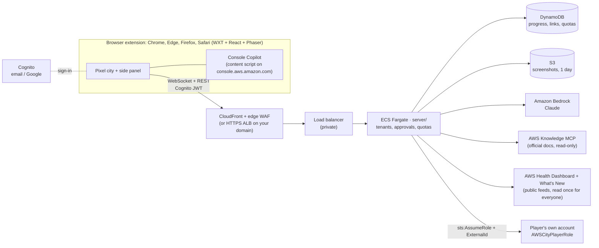

# 🏙️ AWS City

**Learn AWS by living in it.** AWS City is a browser extension (Chrome, Edge, Firefox and Safari) with a living isometric pixel city,
where every AWS service is a place and its agent does that service's real job:
- Sally fishes objects out of **S3 Lake**.
- Sir Shieldon blocks DDoS arrows at the **Shield Wall**.
- Ruby pairs DNS dancers at the **Route 53 Dance Hall**.
- Lola only cooks when an order arrives at the **Lambda Food Stall**.

You are **Kai**. Browse the AWS Console and the city grows with you.

**What you can do**
- **Ask anything.** The agents answer in plain words, grounded in the official AWS docs, with links.
- **Console Copilot.** Tick *Do it in my console* and an agent walks you through real AWS Console
  pages. It highlights each button and explains why; risky buttons are always your click.
- **Build for real, safely.** Connect *your own* AWS account with a small, restricted role. Every
  change waits for your **Approve**.
- **Live AWS status, in the city.** Real outages from the public AWS Health Dashboard show up as a
  news ticker, a throbbing Region on the world map, and storms and fenced landmarks in that Region's
  city (for example, Bahrain's 2026 disruption). Each incident explains what happened and what it
  teaches, with a drill to practise on. AWS What's New launches scroll by too.
- **Learn:**
  - 300 flashcards;
  - architecture puzzles scored on the 6 Well-Architected pillars, including a "Region goes dark" drill;
  - 22 quests that together cover all 36 services, with scenario questions;
  - 6 mini-games whose questions get harder as you play.

---

## For kids and parents: the quick path

1. Install AWS City from your browser's store (below). The city opens in a tab by itself.
2. Press **Play the demo** at the top. No account, no AWS, nothing real is created or charged.
   When you want to keep your city, open the **⋯** menu and pick **Sign in to save your city**.

No store? With [Node 24+](https://nodejs.org) installed, two lines open the demo in its own browser window:

```bash
git clone https://github.com/iloveclouduk/AWS-North-Hackathon.git && cd AWS-North-Hackathon
npm install && npm run open
```

---

## Get AWS City

| Browser | Install | Opens as |
|---|---|---|
| **Chrome**, Edge, Brave, Opera | Chrome Web Store *(link once published)* | side panel |
| **Firefox** 140+ | Firefox Add-ons *(link once published)* | sidebar |
| **Safari** 16.4+ on macOS | Mac App Store *(link once published)* | full city in a tab (Safari has no side panel, so the Lookout and Console Copilot need Chrome, Edge or Firefox) |

Publishing guides: [Chrome Web Store](docs/chrome-web-store.md) · [Firefox Add-ons](docs/firefox-addons.md) · [Safari](docs/safari.md).

---

## Start here: one command

```bash
git clone https://github.com/iloveclouduk/AWS-North-Hackathon.git && cd AWS-North-Hackathon
npm install
npm start
```

`npm start` draws the city, then asks two things and handles the rest:
1. **How do you want to play?** 🎮 the demo (no AWS) · ☁️ real AWS on this computer · 🚀 put it online for everyone.
2. **Which browser?** It lists the ones you have. *AWS City browser* (Chrome for Testing) opens with the extension
   already loaded; Google Chrome, Edge and Brave take 3 guided clicks (they block auto-loading); Firefox opens with it
   loaded; Safari builds the Xcode project and walks you through enabling it.

For real AWS it connects your account the easy way — **sign in with your browser** (`aws login`, no keys to copy),
**paste the keys** from Workshop Studio (it reads them from your clipboard), or **SSO** — checks Claude on Bedrock,
then starts the local server. It remembers your answers for next time. Nothing needs Docker.

**On stage, or in a hurry**, skip the questions:

```bash
npm start -- --demo --browser cft      # straight to the demo in the AWS City browser, zero clicks
npm start -- --demo --browser chrome   # the same in Google Chrome (edge, brave, firefox, safari work too)
npm start -- --help                    # every option (--live for real AWS, --no-intro to skip the animation)
```

Keep the `--`: without it npm keeps the options for itself. Once the city is open the terminal stays its control
panel: **c** brings the city tab forward, **p** opens the S3 practice page, **a** the real AWS console, **r** reopens
the browser and **q** (or Ctrl-C) closes everything. Click once in the city to turn the sound on: browsers keep a page
quiet until you click it.

## Choose your path (the commands behind `npm start`)

| | You need | Time | Command |
|---|---|---|---|
| **1. Play now** (demo agents, no AWS) | Node 24+ | 2 min | `npm run open` |
| **2. Run it on your own AWS** (real agents, sign-in, alarms) | an AWS account | ~25 min, mostly waiting | `npm run setup` |
| **3. Develop against real AWS locally** | an AWS profile with Bedrock, AWS CLI 2.32+ | 5 min | `npm run live` (`-- --help` lists the options) |

### 1 · Play now

```bash
git clone https://github.com/iloveclouduk/AWS-North-Hackathon.git && cd AWS-North-Hackathon
npm install
npm run open          # builds the extension and opens Chromium with it loaded
```

The first run downloads the AWS City browser (Chrome for Testing, about 150 MB) if it isn't there yet.
The guided `npm start` and the scripts are built for macOS first; on Linux and Windows, use
`npm run build` and load `.output/chrome-mv3` yourself (below).

**Using your own Chrome:**
1. Run `npm run build`.
2. Open `chrome://extensions`.
3. Turn on **Developer mode**.
4. Click **Load unpacked** and pick `.output/chrome-mv3`.

**Other browsers (demo mode):**
- Firefox: `npm run dev:firefox` opens Firefox with the extension; click the toolbar icon for the sidebar.
- Safari: `npm run safari:xcode`, press Run in Xcode, then allow unsigned extensions ([docs/safari.md](docs/safari.md)).

**Getting around:**
- The toolbar icon opens the **side panel**; **⋯ → Open the full city in a tab ↗** opens the full-screen city.
- Move Kai by clicking or with **WASD / arrow keys**, and press **E** to talk or enter.
- **⋯ → Replay the tour** shows the first-run tour again.
- `npm run open` opens the city and a safe S3 practice page. Add `-- --console` to open the real AWS console sign-in too.

### 2 · Run it on your own AWS (one command)

```bash
npm install
npm run setup         # a wizard: asks a few questions, checks everything, deploys, builds the extension
```

**Before you start** (the wizard checks these and tells you exactly what's missing):
1. **An AWS account where you're an admin**, signed in on this computer. Use `aws login`
   (AWS CLI 2.32+), `aws configure sso`, or `export AWS_PROFILE=<profile>`.
2. **Claude on Amazon Bedrock.** Serverless models are enabled on first use, but Anthropic asks each
   account (or organization) for a one-time use-case form: in the Bedrock console, open the **Model catalog**,
   pick a Claude model and submit it. The first call also needs `aws-marketplace:Subscribe` and a payment
   method ([AWS docs](https://docs.aws.amazon.com/bedrock/latest/userguide/model-access.html)). The wizard
   checks the Region's Claude models (Opus 5.5 and Sonnet 5.5; Opus 5 and Sonnet 5 in India) and tells you how to
   enable them.

**What the wizard asks** (each answer is saved to `aws-city.config.json`, which is gitignored and
contains no secrets):

| Question | Why | If you're not sure |
|---|---|---|
| Environment | `prod` (players) or `staging` (test copy). Both can live in one account. | `staging` first, then `prod` |
| Region | Where it runs. Claude runs through a Bedrock geo inference profile, so only these Regions work: US and Canada (`us.`), Europe (`eu.`), Sydney/Melbourne (`au.`), Mumbai/Hyderabad (`in.`); the wizard lists them (`infra/lib/models.ts`). | `us-west-2` |
| Web address | A Route 53 domain gives `api.yourdomain.com`; otherwise CloudFront gives free HTTPS. | **No domain** |
| Sign-in page name | Your Cognito sign-in address. The wizard checks it's free. | Accept the suggestion |
| Google sign-in | Optional "Sign in with Google" ([guide](docs/google-sign-in.md)). Email + password always works. | Skip; add it later |
| Alarm email | Alarms and budget alerts. Click the confirmation email AWS sends. | Your email |
| Monthly budget | At 100% the AI switches off automatically; everything else keeps working. | 300 (prod) / 50 (staging) |
| SES sender | Optional: your own "from" address for sign-up emails (Cognito's default sends ~50/day). | Skip |
| Allow the local (unpacked) build | Lets the extension you build on this computer sign in. On by default for staging, off for prod. | Default |
| Chrome Web Store id | Only after you publish ([guide](docs/chrome-web-store.md)). Re-run setup to add it. | Leave empty |
| GitHub deploys | Optional CI/CD with GitHub OIDC (no stored keys). | Skip |

**What it does for you:**
1. Asks before every change to AWS.
2. Bootstraps CDK.
3. Deploys the stacks, which takes about 15–25 minutes the first time.
4. Smoke-tests the live API.
5. Writes `.env.production` and builds the extension, plus a store-ready zip.

**When it's done:**
- **Try it (staging):** in `chrome://extensions`, click **Load unpacked** and pick `.output/chrome-mv3`.
- **Publish:** upload `.output/*-chrome.zip` to the Chrome Web Store
  ([guide](docs/chrome-web-store.md)), then run `npm run setup` again and enter the store id.

**Other commands:**
- `npm run setup -- --dry-run`: see every question and check without changing anything in AWS (it still
  writes your answers to `aws-city.config.json`). This also works without an AWS login.
- `npm run setup -- --env staging`: skip the environment question (`--yes` accepts every saved answer).
- `npm run setup -- --destroy --env staging`: remove that environment's stacks. Tables and buckets are kept,
  so no data is lost by accident.

**Cost while idle:**
- **prod:** roughly **$60–85/month** for two small Fargate tasks, the load balancer, WAF and logs.
- **staging:** roughly **$45–60/month**.
- **Claude on Bedrock:** pay per use, capped per player per day and by your budget.

### 3 · Develop against real AWS locally

```bash
npm start                             # pick "Real AWS": signs you in, checks Claude on Bedrock, then runs live
npm run live                          # the same, without the questions: profile aws-city / workshop / default
npm run live -- --profile me --region eu-west-1 --browser firefox
```

The local server listens on `127.0.0.1` only and uses your profile. Each change still needs your
Approve. It picks up refreshed keys within a minute.

---

## How it works



**Safety model:**
- **Nothing in AWS changes without your Approve.** An agent's write becomes a preview; policy is
  checked again after you approve.
- **We never hold your keys.** Agents act in your account only through the role you install
  (`infra/player-role/player-role.yaml`). It's least-privilege: tiny, tagged, name-prefixed
  resources, locked to one Region, and it trusts only this deployment's server role. Delete the
  `AWSCity` stack to revoke it.
- **Console Copilot runs only when you start it, only on console pages.** It never clicks
  delete / IAM / billing controls and never reads secret fields; press Esc to stop.
- **Costs are capped.** Each player has a daily AI quota, and there's a kill switch
  (`/aws-city/<env>/ai-enabled`). At 100% of the budget, AI is cut off automatically.
- **Architecture:** [docs/well-architected.md](docs/well-architected.md) is our Well-Architected
  review with evidence. Infra passes the cdk-nag AWS Solutions checks.

## Project tour

```
src/          the extension: app/ (shell), ui/ (panels), game/ (Phaser city), console/ (Copilot), backend/ (the only network I/O)
shared/       content as data: 36 services, flashcards, puzzles, quests, culture, regions
art/          pixel-art generators (characters, city tiles, landmarks) → public/assets
server/       the backend (Node + TS): agents on Bedrock, approvals, tenants, stores — local or hosted
infra/        CDK stacks (data, auth, service, edge WAF, budget, CI) + setup wizard + player role
scripts/      open / live / smoke tests / asset fetchers
docs/         contract, runbook, privacy policy, store listing, Google & Chrome Web Store guides
```

| Command | What it does |
|---|---|
| `npm run check` | Type-check + unit tests (extension), React component tests included |
| `npm run lint` | ESLint: rules of hooks and accessibility (jsx-a11y) |
| `npm run smoke` / `smoke:copilot` | Playwright runs; screenshots in `.output/smoke`; must print "no page errors" |
| `cd server && npm test` | Server tests (auth, tenants, approvals, Copilot, docs grounding, player-role drift) |
| `cd infra && npm test && npx cdk synth -q` | Infra tests + cdk-nag |
| `npm run art` | Regenerate the pixel art |

The backend contract is [docs/backend-contract.md](docs/backend-contract.md); its source of truth is
`src/backend/contract.ts`. Operations (kill switch, alarms, restores, support) are in
[docs/runbook.md](docs/runbook.md).

## Troubleshooting

| Symptom | Fix |
|---|---|
| Setup: *Bedrock model access is not ready* | Submit Anthropic's one-time use-case form (Bedrock → Model catalog → a Claude model) and check `aws-marketplace:Subscribe` + a payment method; wait a few minutes, then re-run. |
| Setup: *sign-in name is taken* | Pick another name; it can't contain `aws`, `amazon` or `cognito`. |
| Deploy fails building the image | The image is built in AWS CodeBuild: the error links to the build log (CloudWatch → `/aws/codebuild/ContainerImageBuildArm64…`). |
| `npm run dev` shows a blank page | Branded Chrome blocks auto-loading; install the AWS City browser once with `npx playwright install chromium` (or just use `npm start`). |
| No alarm or budget emails | Click **Confirm subscription** in the AWS Notifications email. |
| "Sign in" loops in the extension | That build's extension id isn't allowed: re-run `npm run setup` (allow the local build, or add the store id). |
| "The city's AI is resting" | The kill switch is off or the budget was hit (see the [runbook](docs/runbook.md)). |
| Player can't link their account | Create the stack from the in-game link *in the same Region*, then paste the 12-digit account id. |

## For contributors using Claude Code

This repo uses the official AWS plugins from the [Agent Toolkit for AWS](https://github.com/aws/agent-toolkit-for-aws),
enabled in `.claude/settings.json`. Install them once:

```
/plugin install aws-core@claude-plugins-official      # AWS skills (CDK, IAM, containers, networking, security, cost, Well-Architected…)
/plugin install aws-agents@claude-plugins-official    # AWS Knowledge MCP (official docs)
/reload-plugins
```

Note that aws-core's AWS MCP server can call AWS APIs **with your credentials**. It's for your own
development session only, and the game's agents never use it (see `CLAUDE.md`).

## Credits

- **Characters:** the team's Habbo-style pixel generator (`art/characters`).
- **City pack:** imported pixel-for-pixel from the team's `agentic-city` prototype (`art/pack`).
- **Everything else:** generated in that style (`art/tiles`).
- **AWS Architecture Icons** © Amazon Web Services, used as provided for architecture diagrams
  (`public/assets/aws-icons/NOTICE`). AWS, Amazon and the service names are trademarks of Amazon.
  AWS City is an independent learning project, not affiliated with or endorsed by Amazon.
- **Fonts:** Nunito and Press Start 2P (OFL).
- **Sounds:** [Kenney](https://kenney.nl), CC0.
- **Learn more reading:** each building links (never copies) to [Tutorials Dojo](https://tutorialsdojo.com/aws-cheat-sheets/)
  cheat sheets, [AWS Fundamentals](https://awsfundamentals.com/blog) articles and its book, and O'Reilly books
  (*AWS Cookbook*, *Serverless Development on AWS*, *Generative AI on AWS*), credited with their authors
  (`shared/further-reading.json`). The game's own cards are in our words and cite AWS docs.
